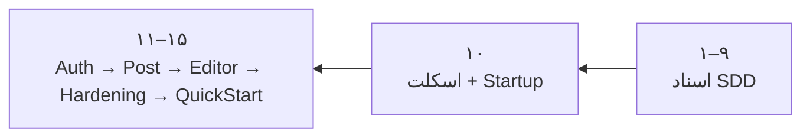
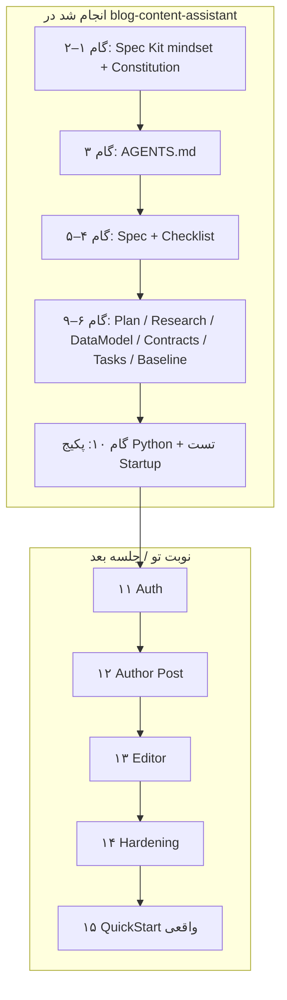
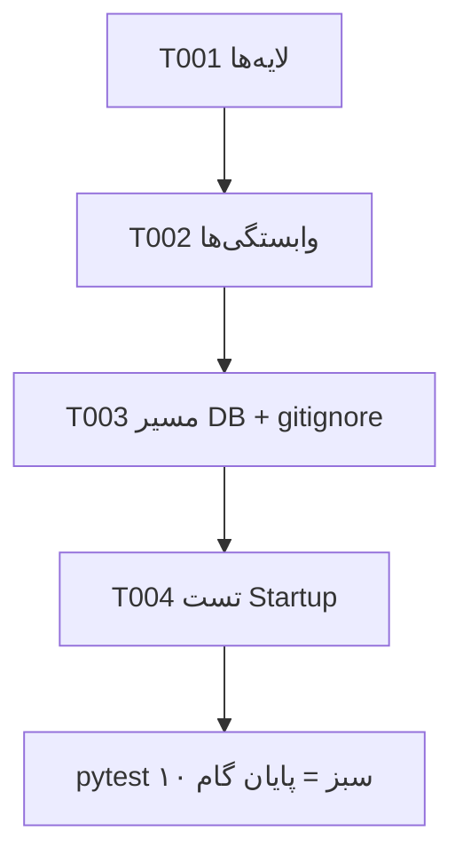

<div dir="rtl" lang="fa">

# گزارش تکلیف‌محور: معادل گام‌های ۱ تا ۱۰ کارگاه (Python)

> این آزمایشگاه **کپی BlogSpecLab استاد نیست**. همان مسیر SDD کارگاه را با پشتهٔ Python طی می‌کند تا آمادهٔ گام‌های ۱۱–۱۵ باشی.

## جواب کوتاه: الان کجایی؟



**انجام‌شده:** گام‌های مفهومی ۱–۱۰  
**انجام‌نشده:** Auth واقعی، Aggregate پست، Editor، Public Hardening (۱۱–۱۵)

---

## نقشهٔ گام‌ها ↔ پوشه‌های این ریپو



| گام کارگاه | در این پروژه چه ساخته شد؟ |
|------------|---------------------------|
| ۱ Bootstrap | ساختار مخزن + `pyproject.toml` (به‌جای `specify init` روی .NET) |
| ۲ Constitution | `.specify/memory/constitution.md` — قواعد Python، نه csproj |
| ۳ AGENTS.md | راهنمای عامل به فارسی |
| ۴–۵ Specify | `specs/001-blog-post-management/spec.md` + checklist |
| ۶–۹ Plan… | `plan.md`, `research.md`, `data-model.md`, `contracts/`, `tasks.md`, `technical-baseline.md` |
| ۱۰ فاز ۱ | لایه‌های خالی + FastAPI `/health` + تست‌های Fail-fast تنظیمات |

---

## چه کارهایی عمداً انجام نشد؟ (مهم برای تکلیف)

- کپی کد یا نام‌گذاری یک‌به‌یک از `Workshop-1/Samples`
- پیاده‌سازی T005+ (Auth / Post) — مال گام ۱۱ به بعد
- AI، MCP، RAG
- Migration و ساخت فایل DB در Startup

---

## شواهد فاز ۱ (T001–T004)



دستور:

```powershell
cd blog-content-assistant
python -m venv .venv
.\.venv\Scripts\Activate.ps1
pip install -e ".[dev]"
pytest
```

---

## قدم بعدی دقیق (گام ۱۱)

1. پرامپت کارگاه `Workshop-1/Prompts/step11/Auth.txt` را **بخوان** (ایدهٔ فاز، نه کپی C#).
2. در همین پروژه Taskهای T005–T011 را در `tasks.md` ریز کن و پیاده کن:
   - `UserAccess` / خواندن Permission سروری  
   - Credential hash  
   - Bearer فقط هویت  
   - Fail-fast تنظیمات Auth در صورت نیاز  
3. هنوز Domain پست نساز (آن گام ۱۲ است).

</div>
