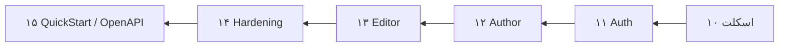
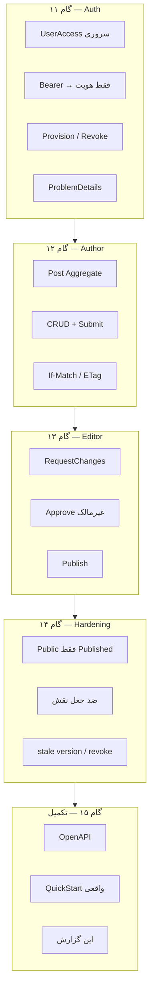
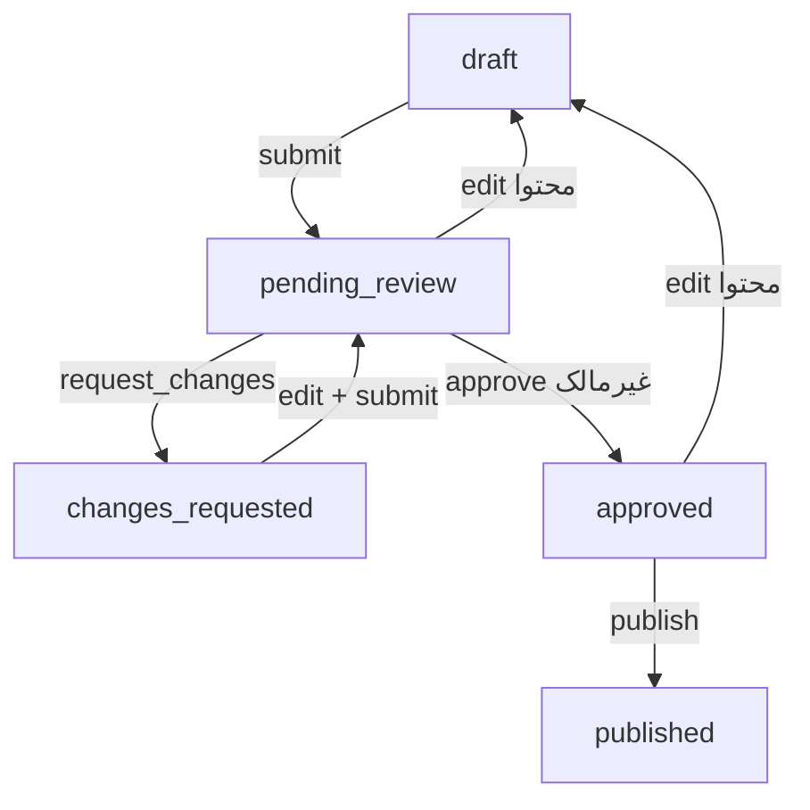

<div dir="rtl" lang="fa">

# گزارش تکلیف: گام‌های ۱۱ تا ۱۵ کارگاه (پیاده‌سازی ساده‌شدهٔ Python)

> مسیر مفهومی Workshop-1 بدون کپی کد .NET استاد. پشته: FastAPI + SQLite + pytest.

## جواب کوتاه



**وضعیت:** گام‌های ۱۱–۱۵ در `blog-content-assistant` پیاده و با `pytest` (۲۲ تست) اثبات شده‌اند.

---

## نقشهٔ فاز ↔ کد



| گام | چه ساخته شد؟ | مسیرهای اصلی |
|-----|--------------|--------------|
| ۱۱ | هویت opaque، Permission سروری، ops provision/revoke، خطای 401 | `application/security.py`, `api/deps.py`, `api/ops` |
| ۱۲ | Domain پست + Author API | `domain/posts.py`, `AuthorPostService`, `/api/author/*` |
| ۱۳ | صف ویراستار، برگشت، تأیید، انتشار | `EditorPostService`, `/api/editor/*` |
| ۱۴ | Public API، ماتریس امنیت ساده، Version | `/api/posts`, تست‌های hardening |
| ۱۵ | OpenAPI خودکار FastAPI، QuickStart، گزارش | `/openapi.json`, `quickstart.md` |

---

## جریان کسب‌وکار (بعد از پیاده‌سازی)



قواعد کلیدی که در کد enforce شده‌اند (نه فقط Prompt):

- Header نقش/مالکیت نمی‌سازد  
- خودتأییدی ممنوع  
- Public فقط `published` و بدون فیلدهای مدیریتی  
- نبود `If-Match` → 428 ؛ نسخهٔ کهنه → 412  
- Publish تکراری اطلاعات انتشار نخست را عوض نمی‌کند  

---

## شواهد تست

```text
pytest  →  22 passed
```

پوشش تقریبی:

- Startup Fail-fast (گام ۱۰ ماندگار)
- Domain transitions
- Auth 401 / revoke / جعل نقش
- Author isolation + submit
- Editor مسیر کامل تا publish
- Public 404 برای غیرعمومی
- OpenAPI شامل مسیرهای اصلی

---

## ساده‌سازی نسبت به نمونهٔ استاد (عمدی)

| استاد (.NET) | این آزمایشگاه |
|--------------|----------------|
| چند پروژه csproj / EF / MediatR | یک پکیج Python لایه‌بندی‌شده |
| Migrationهای غنی | `init_schema` صریح در provision/تست |
| ماتریس امنیتی بسیار گسترده | سناریوهای اصلی اثبات‌شده |
| ETag UUID با قواعد کامل ASP.NET | Version UUID + If-Match |

هدف تکلیف: **تکمیل مسیر ۱۱–۱۵ و اثبات رفتار**، نه parity خط‌به‌خط.

---

## قدم بعد (خارج از این تکلیف)

- Feature دوم AI / Content Review (گام ۱۶+)
- یا Homework Session-05 (Tool Calling / MCP) روی همین Blog Service

</div>
