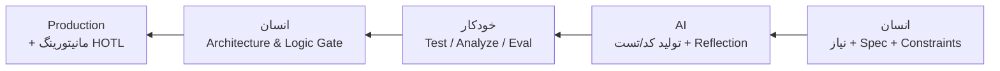
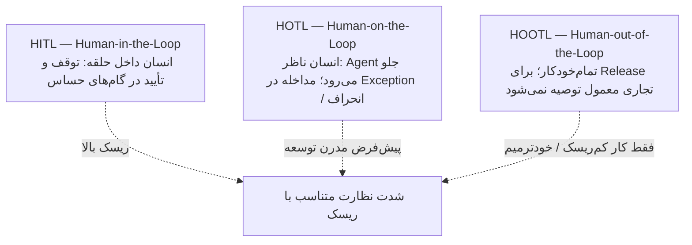
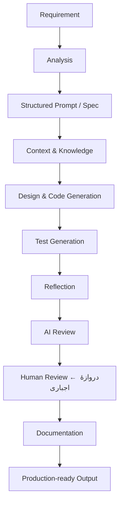
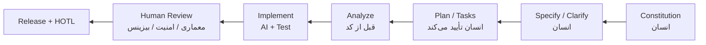

# چرخهٔ استاندارد حضور انسان در تولید نرم‌افزار (عصر Agentها)

> تکلیف کلاسی — پژوهش شخصی، هم‌راستا با رویکرد دوره («فراتر از Vibe Coding» و حفظ مسئولیت مهندسی) و ادبیات صنعت (HITL / HOTL، حاکمیت ریسک، SDD).

## جواب یک‌خطی

چرخهٔ درست این نیست که انسان روی **هر توکن** Stop & Approve بزند (گلوگاه + Rubber-stamping)، و نه اینکه انسان از Production حذف شود.  
استاندارد عملی: انسان **در ابتدا Spec و Guardrail می‌سازد**، حلقهٔ میانی را به **تست / Eval / Reflection خودکار** می‌سپارد، و **در انتها دروازهٔ معماری–امنیت–بیزینس (Human Review)** را نگه می‌دارد — با نظارت HOTL بعد از انتشار.

---

## ۱) چرا نقش انسان بازتعریف شده؟

| قبل | الان (بدون طراحی درست) | خطر |
|-----|------------------------|------|
| انسان نویسندهٔ اصلی خطوط کد | AI حجم زیادی کد تولید می‌کند | اگر انسان همه را خط‌به‌خط بخواند → **Bottleneck** |
| بازبینی دستی قابل‌تحمل بود | Diffهای بزرگ و تکراری | **Rubber-stamping** (تأیید کور از خستگی) |
| خطا عمدتاً انسانی بود | خطای مدل + فرض پنهان + API ساختگی | بدون نظارت، باگ/ریسک Production بالا می‌رود |

دوره همین را می‌گوید: سرعت تولید به‌تنهایی هدف نیست؛ کنترل خروجی، اعتبارسنجی و مسئولیت مهندسی باید بماند.

---

## ۲) سه سطح حضور انسان

1. **HITL:** AI در نقاط حساس متوقف می‌شود؛ انسان تأیید / اصلاح / رد می‌کند.  
   *مثال:* تغییر زیرساخت بحرانی، PR پرخطر، تصمیم بیزینسی برگشت‌ناپذیر.
2. **HOTL (رویکرد غالب Agentic):** جریان را Agentها و ابزارها جلو می‌برند؛ انسان ناظر Guardrail، متریک و خروجی است و در استثنا وارد می‌شود.  
   *مفهوم مرتبط:* **Harness Engineering** — انسان بستر، تست، Spec و Rule می‌سازد تا Agent مهار شود (نه اینکه فقط تایپ کد کند).
3. **HOOTL:** بدون انسان؛ در مهندسی نرم‌افزار تجاری برای مسیر به Production معمولاً قابل قبول نیست، مگر وظایف کم‌ریسک و محدود.

**نکتهٔ عملی:** شدت نظارت **ثابت نیست** — پیش‌فرض HOTL + ارتقا به HITL وقتی ریسک بالا است (امنیت، داده، پول، مهاجرت شکسته).

---

## ۳) چرخهٔ استاندارد Agentic SDLC (نقش انسان کجاست؟)

تفکیک نقش‌ها:

- **انسان:** شناختی–معماری — Framing، Spec، Constraint، Accountability  
- **AI:** تولید–تبدیل — پیش‌نویس کد/تست، پیشنهاد، Reflection کمکی  
- **خودکار:** Quality Gate میانی — Test، Analyze، Linter، Eval

### ۳.۱ هم‌راستا با مسیر دوره

منبع مسیر: README مخزن دوره (`SoftwareEngineering-GenAI-0505`).

### ۳.۲ هم‌راستا با کارگاه SDD

### ۳.۳ گام‌های کلیدی حضور انسان

1. **Input & Framing** — صورت‌مسئله، Scope، Context Engineering  
2. **Spec-Driven** — پیش‌شرط / پس‌شرط / Acceptance؛ AI پیاده‌سازی می‌کند  
3. **Quality Gates** — بدهی فنی، امنیت، Hallucinated API، انحراف معماری  
4. **Accountability** — مدل مالک اخلاقی/حقوقی نیست؛ مسئولیت Production با مهندس است  

---

## ۴) جدول دفاع در کلاس

| دیدگاه | محور | نقش انسان |
|--------|------|-----------|
| سنتی + ابزار کمکی (HITL سنگین) | Copilot / پیشنهاد خطی | نوشتن یا تأیید تقریباً خط‌به‌خط |
| مدرن Agentics (HOTL) | ارکستراسیون Agent + Harness | طراح سیستم، سازنده Guardrail، ناظر متریک |
| حاکمیت سازمانی | ریسک / انطباق / امنیت | دروازهٔ نهایی برای تغییر پرریسک |

> **جملهٔ کلیدی:**  
> چرخهٔ درست = دیکتهٔ **Spec و محدودیت در ابتدا** + سپردن حلقهٔ میانی به **Test/Eval** + تضمین **اعتبارسنجی معماری و پیامد بیزینسی در انتها** — نه Stop روی هر توکن، و نه حذف انسان از Production.

---

## ۵) جمع‌بندی با Workshop

| فاز کارگاه | حضور انسان |
|------------|------------|
| Constitution / Spec / Plan / Tasks | انسان مالک تصمیم است (حتی اگر AI پیش‌نویس کند) |
| Implement تکه‌تکه + Test | HOTL روی Diff کوچک؛ HITL اگر مرز معماری بشکند |
| Analyze قبل از کد | جلوگیری از هزینهٔ پیاده‌سازی اشتباه |
| قبل از Production | Human Review اجباری (دوره صریح می‌گوید خروجی AI بدون بررسی پذیرفته نیست) |

---

## ارجاع مفهومی

- مسیر دوره: README → بخش رویکرد آموزشی و Human Review  
- کارگاه: `Workshop-1` (SDD فازبه‌فاز، نه Vibe)  
- ادبیات صنعت (چارچوب پاسخ): HITL / HOTL / HOOTL، حاکمیت ریسک، گذار از «نویسندهٔ خط» به «معمار / ناظر سیستم»

*این یادداشت سنتز پژوهشی برای پاسخ کلاسی است؛ ادعاهای آماری منابع ثانویه را در ارائه به‌عنوان چارچوب مفهومی بیان کن، نه نقل‌قول دقیق گزارش بدون منبع.*

