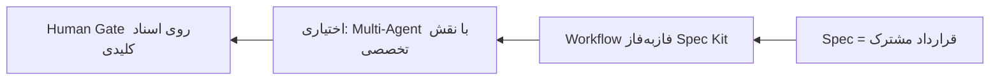
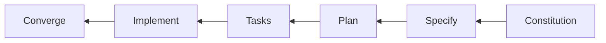
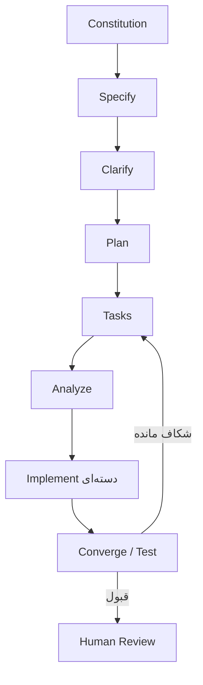
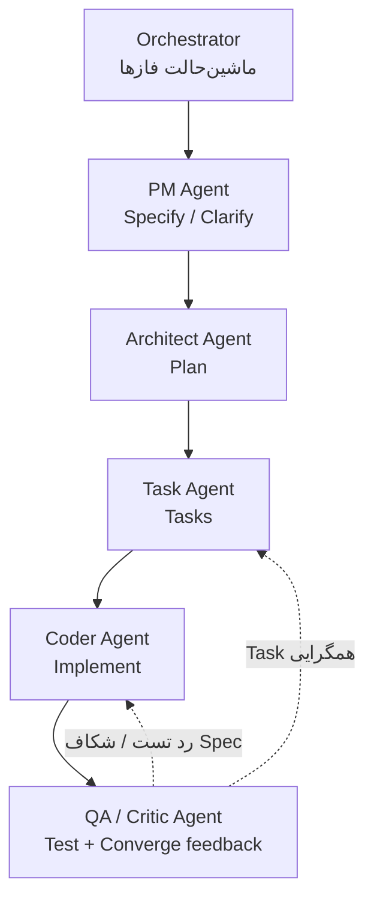
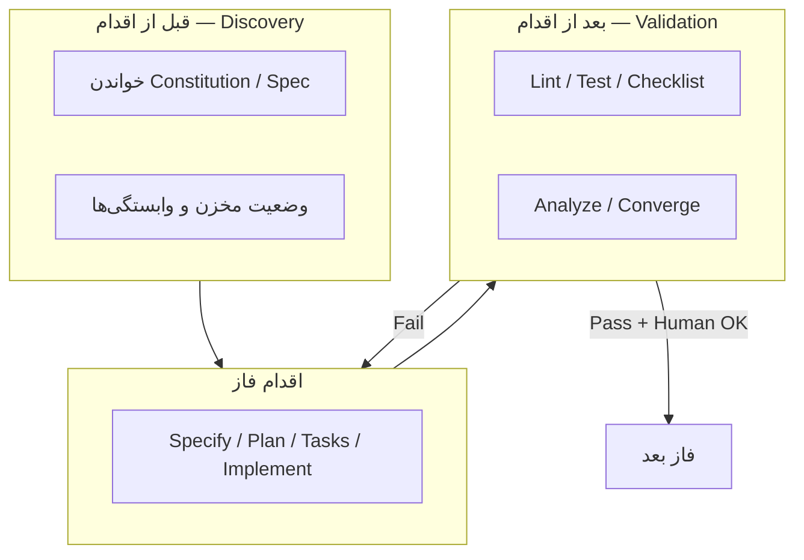

# Multi-Agent و Workflow در Spec Kit / SDD

> تکلیف تحقیق کلاسی — هم‌راستا با سرفصل دوره (Spec-Driven Development، Multi-Agent Collaboration) و کارگاه BlogSpecLab.

## جواب یک‌خطی

> ترکیب Spec Kit با Multi-Agent، تولید نرم‌افزار را از پرامپت سلیقه‌ای به **خط تولید مهندسی** نزدیک می‌کند: هر فاز را یک نقش متخصص جلو می‌برد و **Spec** قرارداد مشترک انسان و ماشین است — نه اینکه چند Agent بدون Spec شلوغ کنند.

---

## ۱) مسئله: چرا Workflow ساخت‌یافته لازم است؟

بدون ساختار (Vibe / Ad-hoc) معمولاً این‌ها رخ می‌دهد:

| پدیده | معنی کوتاه |
|--------|------------|
| Context Blindness | مدل تصویر ناقص/غلط از پروژه دارد |
| Architecture Drift | خروجی از Constitution / لایه‌ها منحرف می‌شود |
| Hallucination | API، مسیر فایل یا تابع ساختگی |

**Spec Kit** (ابزار متن‌باز هم‌راستا با SDD) کار را داخل **قرارداد و فاز** نگه می‌دارد: اول Spec/Plan/Tasks، بعد Implement — نه یک پرامپت تصادفی برای کل سیستم.

---

## ۲) Workflow پایهٔ Spec Kit (و نسخهٔ کامل‌تر دوره)

### ۲.۱ هستهٔ خطی (همان تحقیق)

| فاز | نقش |
|-----|-----|
| Constitution | اصول، خط قرمز، جهت وابستگی |
| Specify | رفتار، Acceptance، Edge |
| Plan | معماری و تصمیم فنی |
| Tasks | کارهای اتمیک با وابستگی |
| Implement | پیاده‌سازی محدود و تست‌پذیر |
| Converge | بستن شکاف Spec↔کد؛ در صورت نیاز Task تازه |

### ۲.۲ حلقه‌های کنترلی که در کارگاه هم دیده می‌شود

**نکته برای کلاس:** Multi-Agent جایگزین این فازها نیست؛ روی **همین ماشین‌حالت** سوار می‌شود. انسان هنوز Gate اصلی روی Spec/Plan/Tasks و Review نهایی را دارد (نگاه کنید به تحقیق `human-in-agentic-sdlc.md`).

---

## ۳) پیوند Multi-Agent با Spec Kit

### ۳.۱ چرا چند Agent؟

یک پرامپت/یک Agent هم‌زمان نمی‌تواند با کیفیت بالا همهٔ نقش‌ها را بازی کند:

Product analysis · Architecture · Task breakdown · Coding · QA/Review

**Role Specialization** کیفیت را بالا می‌برد — به شرطی که ورودی/خروجی هر نقش همان Artifactهای SDD باشد (`spec.md`, `plan.md`, `tasks.md`, …).

### ۳.۲ نقش‌های پیشنهادی روی خط لوله

| Agent | فاز Spec Kit | خروجی مورد انتظار |
|-------|--------------|-------------------|
| PM | Specify (+ Clarify) | `spec.md` قابل آزمون |
| Architect | Plan | `plan.md` + قراردادها |
| Task Decomposer | Tasks | `tasks.md` اتمیک |
| Coder | Implement | Diff کوچک + تست |
| QA / Critic | Converge / Review | شکاف، پوشش، امنیت اولیه |
| Orchestrator | همه | انتقال وضعیت؛ جلوگیری از پرش فاز |

### ۳.۳ مرز واقع‌بینانه

- **Spec Kit** عمدتاً Workflow، قالب، Skill (`$speckit-*`) و **Hooks** می‌دهد.
- **Multi-Agent** اغلب انتخاب Host/ارکستراتور است (چند session، چند نقش، یا تیم Agent).
- بدون Spec مشترک، Multi-Agent فقط «چند Vibe موازی» می‌شود.

---

## ۴) ترکیب‌پذیری: Workflow، Extension، Hook

مفاهیم مفید برای ارکستراسیون (در اکوسیستم Spec Kit / عامل کدنویسی):

| سازوکار | کاربرد |
|---------|--------|
| Workflow / Overlay | سفارشی‌سازی مراحل تیم (مثلاً Security gate) |
| Extension / Bundle | بسته‌بندی نقش یا ابزار تکراری |
| Discovery Hook | Grounding قبل از Plan/Code |
| Validation Hook | Test/Lint قبل از اجازهٔ عبور فاز |

---

## ۵) مقایسه برای دفاع در کلاس

| شاخص | Vibe / Ad-hoc | Spec Kit (+ Multi-Agent اختیاری) |
|------|----------------|----------------------------------|
| مبنای کار | چت پراکنده | Spec / Plan / Tasks مدون |
| تخصص | یک Agent همه‌کاره | نقش‌های جدا روی همان Artifactها |
| Hallucination | بالاتر | کمتر با Gate و Hook |
| نقش انسان | بازبینی Diff بزرگ | تأیید اسناد + Human Review |
| کار تیمی | سخت | نزدیک‌تر به SDLC سازمانی |

---

## ۶) جملهٔ آمادهٔ کلاسی

> Spec Kit مسیر را فازبندی و قرارداد محور می‌کند؛ Multi-Agent روی همان مسیر، تخصص نقش می‌آورد. بدون Spec، چند Agent فقط هرج‌ومرج را موازی می‌کنند. با Spec، خط تولید شکل می‌گیرد و انسان به‌جای Stop روی هر توکن، روی اسناد و دروازهٔ نهایی تمرکز می‌کند.

---

## ارجاع

- سرفصل دوره: Spec-Driven Development، Multi-Agent Collaboration  
- کارگاه: `Workshop-1` و Skillهای `$speckit-specify` … `$speckit-converge`  
- تحقیقات مرتبط همین مخزن: `spec-vs-plan-prompt.md`، `human-in-agentic-sdlc.md`

*این سند سنتز پژوهشی برای ارائهٔ کلاسی است؛ جزئیات Extensionها بین نسخه‌های Spec Kit ممکن است فرق کند — اصل مهم Workflow + Artifact + Gate است.*

