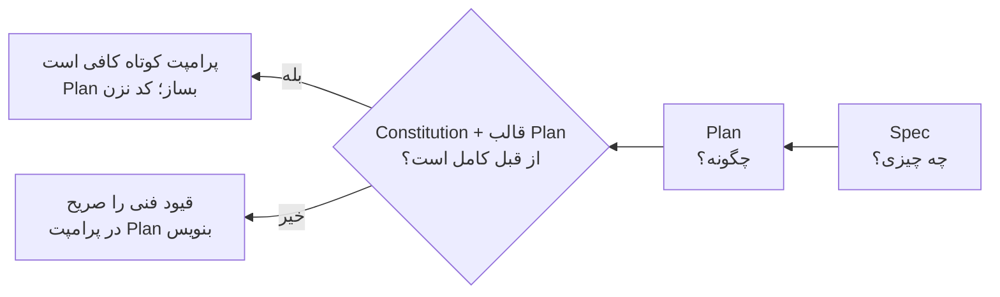
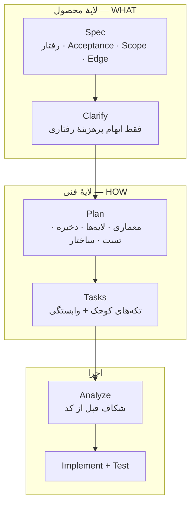
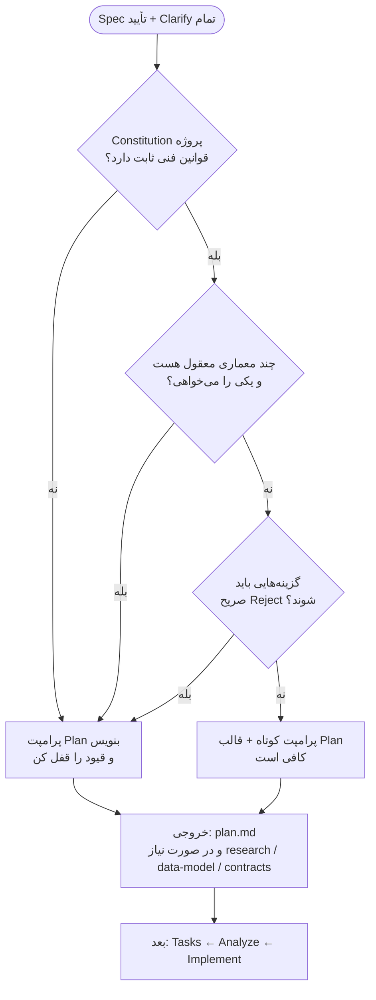
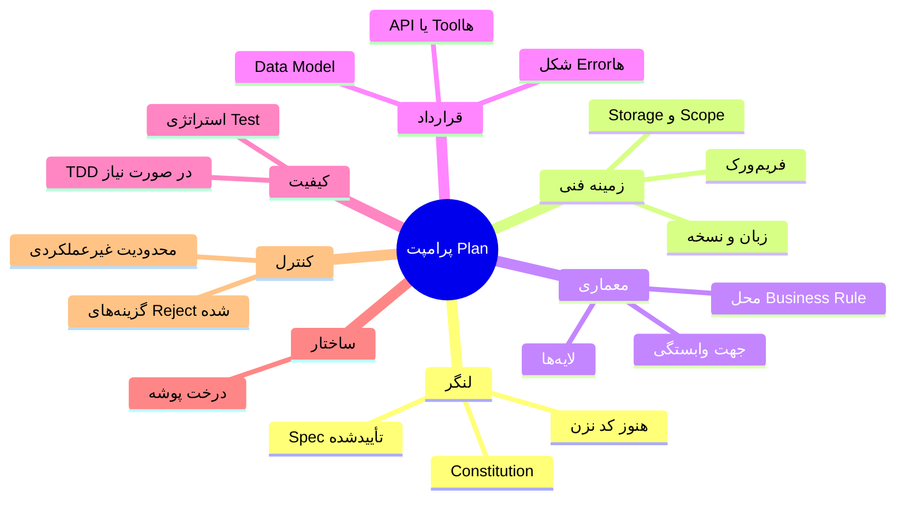
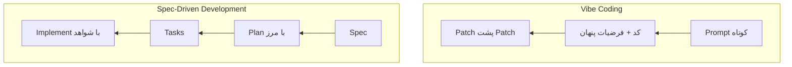
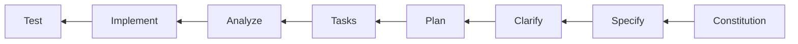

# Spec تعریف شده؛ آیا باید برای Plan پرامپت بنویسیم؟

> یادداشت شخصی از سؤال کلاسی دوره — هم‌راستا با مسیر SDD و Promptهای زندهٔ Session-01.

---

## جواب یک‌خطی

**خلاصه:** Spec به‌تنهایی «چگونه پلن کن» را کامل نمی‌کند. نوشتن متا-پرامپت طولانی اجباری نیست؛ **دادن مرزهای فنی (یا داشتنشان در Constitution / قالب)** ضروری است — وگرنه مدل فرضیات معماری را مثل Vibe Coding داخل Plan می‌گذارد.

---

## ۱) نقش هر سند

| سند | سؤال | در پرامپت چه بگویی؟ |
|-----|------|---------------------|
| Spec | سیستم *چه* کند؟ | User Story، Acceptance، Edge — **نه** کلاس و فریم‌ورک |
| Plan | *چگونه* بسازیم؟ | زبان، معماری، جهت وابستگی، تست — **هنوز کد نزن** |
| Tasks | *به چه ترتیب؟* | کارهای کوچک متصل به Requirement |

---

## ۲) تصمیم: پرامپت Plan بنویسم یا نه؟

### مثال دوره (Prompt زندهٔ Session-01)

بعد از Spec، استاد **عمداً** قیود Plan را می‌نویسد: Onion، CQRS/MediatR، جهت وابستگی، روش تست — و «هنوز کد نزن».

منبع: `Session-01/Prompts/LIVE-PROMPTS-FA.md` (مرحلهٔ ۳ — معماری).

---

## ۳) اگر پرامپت Plan می‌نویسیم، چه چیزهایی داخلش باشد؟

### چک‌لیست سریع (کپی در چت)

- [ ] ارجاع به Spec تأییدشده + Constitution  
- [ ] «هنوز کد نزن»  
- [ ] زبان / فریم‌ورک / نوع پروژه  
- [ ] Storage و آنچه خارج از Scope است  
- [ ] لایه‌ها و جهت وابستگی  
- [ ] کجا Rule enforce می‌شود (Application، نه فقط Prompt)  
- [ ] استراتژی Test  
- [ ] ساختار پوشه‌ها  
- [ ] گزینه‌های Reject شده + دلیل کوتاه  
- [ ] خروجی مورد انتظار: `plan.md` (و در صورت نیاز data-model / contracts)

### چه چیزهایی داخل پرامپت Plan نباشد

| نگذار | چرا |
|--------|-----|
| کد خط‌به‌خط | آن Implement است |
| تکرار تمام Acceptance | ارجاع به Spec کافی است |
| «هر طور قشنگ شد معماری کن» | دوباره Vibe در لباس Plan |
| ابهام محصول (مثلاً ایمیل یکتا؟) | آن Clarify است، نه Plan |

---

## ۴) مقایسه با Vibe Coding

در Vibe، Agent هم‌زمان تحلیلگر محصول، معمار و برنامه‌نویس است.  
در SDD قبل از پیاده‌سازی، **مرجع حقیقت (Spec)**، **مرز تصمیم (Plan / Constitution)** و **تعریف پایان (Acceptance / Test)** بسته می‌شود.

---

## ۵) جملهٔ آماده برای پاسخ کلاسی

> Spec مرجع «چه چیزی» است؛ Plan مرجع «چگونه». نوشتن پرامپت طولانیِ «چگونه فکر کن» اجباری نیست اگر Constitution و قالب Plan موجود باشند؛ اما دادن قیود فنی، مرز لایه‌ها، تست و گزینه‌های Reject شده برای Plan ضروری است — وگرنه مدل فرضیات معماری را مثل Vibe Coding داخل Plan می‌گذارد. بعد Plan را به Tasks می‌شکنیم و قبل از کد Analyze می‌کنیم.

---

## ۶) مسیر کامل SDD (یادآوری)

---

## ارجاعات

- Promptهای زنده: مخزن دوره ← `Session-01/Prompts/LIVE-PROMPTS-FA.md`
- راهنمای Spec Kit: مخزن دوره ← `Session-02/Documets/SpecKit-Workshop-Guide-fa.md`
- نمونهٔ Plan: مخزن دوره ← `Session-01/Samples/SDD/specs/001-user-profile/plan.md`

